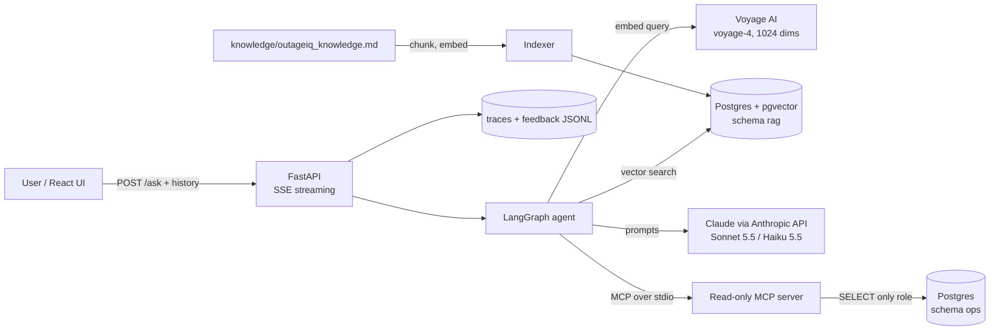
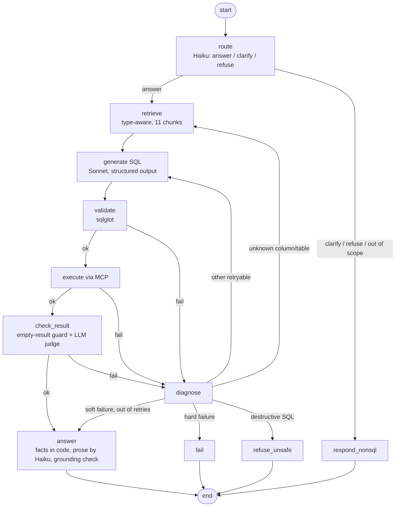
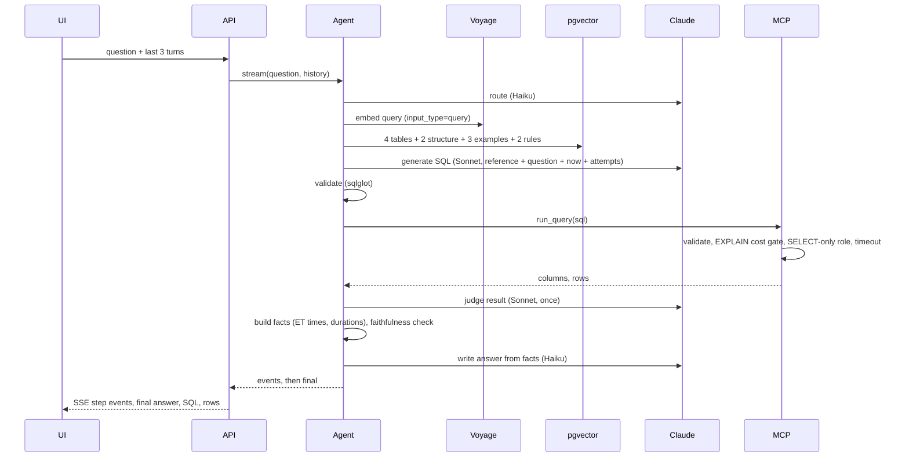

# OutageIQ: the application, end to end

> **Status as of 2026-10-10.** Everything described here is built and unit-tested (94 tests; none needs the
> network, the MCP ones run a real stdio subprocess against a fake backend). The **first full evaluation (v1) has been run** on the 30-question
> held-out set; its results are in section 14.1. Numbers marked *measured* come from real runs in this
> repository (the retrieval evals, the v1 agent eval, indexing output, and the live traces in `data/traces/`).
> Numbers marked *list price* or *estimate* are not measurements. **PENDING** marks experiments that have not
> been run (the ablations in `docs/EXPERIMENTS.md`). Unfamiliar term? See the glossary in
> `docs/02-EVALUATION-TOKENOMICS-AND-MODELS.md` (Appendix A); caching is covered in its section 8.

---

## 1. What OutageIQ is

A network-operations team asks questions in plain English about outages, tickets, sites and alarms.
The system retrieves the relevant **schema documentation, join paths and example queries** from a vector
store, has an LLM write SQL, runs it through a **read-only MCP server**, and answers in clear prose. When the
SQL fails or the result looks wrong, a **LangGraph repair loop** feeds the problem back to the LLM and tries
again, up to a fixed limit.

A real run (from `data/traces/`, *measured*): "What are the details of outage 1234?" produced

> Outage **1234** at site **NJ-EDISON-042** is a critical OOS outage in the RAN domain that started
> 2026-09-14 08:12 EDT and ended 2026-09-14 11:47 EDT, lasting **3 h 35 min**; it is closed. It affected
> 3 cells and 1,850 customers, with root cause Transport/Physical: fiber cut on the backhaul link. Ticket
> **INC-55821** (closed, created 2026-09-14 08:20 EDT) is assigned to Priya Shah of Field Ops, NJ-Central.

in 14.9 s for $0.0189 (4 LLM calls, 8,288 input tokens, 746 output tokens). Every value in that answer is
read from a database row; the duration and the Eastern times are computed by code, not by the LLM.

All data is **synthetic**. No real company data, schemas or ticket formats are used.

### What this project is really about
Text-to-SQL is easy to demo and hard to make trustworthy. The project owns the hard parts:
retrieval quality, a self-correcting agent loop, defence in depth for read-only access, deterministic
formatting, grounding, and **measurement** (golden dataset, retrieval and SQL metrics, cost and latency).

---

## 2. Architecture

### 2.1 System view



Postgres runs on the owner's existing AWS RDS instance (us-east-2), in its own `outageiq` database, with
TLS required and four least-privilege roles (section 11).

### 2.2 The agent graph (LangGraph)



### 2.3 One request, as a sequence



---

## 3. Repository map

| Path | Role |
|---|---|
| `knowledge/outageiq_knowledge.md` | The single source of schema knowledge (27 KB): rules, glossary, 10 table docs, join paths, refusal guidance, 18 verified example queries |
| `db/migrations/` | `0001_ops_schema.sql` (10 tables), `0002_rag_schema.sql` (vector store) |
| `db/admin/` | One-time bootstrap SQL the owner runs (database, roles, extension, grants, verify) |
| `datagen/` | Seeded synthetic data generator and loader |
| `common/` | DB connections per role, embedding facade, Anthropic wrapper, knowledge parser |
| `rag/` | Chunking, indexer, retriever |
| `agent/` | Config, prompts, validator, facts, LangGraph, runner |
| `mcp_server/` | Read-only MCP server and its backends |
| `api/` | FastAPI service |
| `frontend/` | React + TypeScript (Vite) chat UI |
| `evals/` | Golden dataset, metrics, comparators, retrieval and agent evaluators |
| `scripts/` | Migrate, connection checks, example checks, `ask` CLI |
| `tests/` | 94 offline tests |
| `docs/` | ADRs, this guide, the evaluation guide, interview Q&A |

---

## 4. The data

### 4.1 Schema (schema `ops`)

| Table | Rows | Purpose |
|---|---|---|
| `sites` | 60 | Cell sites (code like `NJ-EDISON-042`, city, state, region) |
| `users` | 24 | Employees who work tickets (team, region) |
| `root_causes` | 14 | Catalog: category, subcategory, description |
| `outages` | 1,420 | The hub: type (OOS/SC/TIS/MO), domain (RAN/Core/Transport), priority, `start_time`, `end_time` (NULL = still open), generated `is_open` |
| `outage_root_causes` | 1,548 | Many-to-many with `is_primary` |
| `alarms` | 4,847 | Equipment alarms per outage |
| `outage_updates` | 4,934 | Timeline notes |
| `tickets` | 1,259 | `ticket_number` (INC-…), status, priority, assignee, business-time `created_at` / `resolved_at`, generated `is_resolved` |
| `ticket_assignments` | 1,343 | Assignment history (reassignment) |
| `impacted_services` | 2,896 | Customers impacted per service per outage |

Design choices that exist to make text-to-SQL *easier and safer*, and the reasoning:

- **`<entity>_id` primary keys, distinct business keys** (`ticket_number`, `site_code`): a bare `id` in every
  table is a classic source of wrong joins (ADR 0004).
- **All times are `timestamptz`** stored in UTC; display conversion to Eastern happens in code (ADR 0003).
- **Generated columns `is_open` and `is_resolved`** remove redundant facts that could disagree.
- **CHECK constraints** (status vs `resolved_at`, `end_time >= start_time`) so bad generator output fails loudly.
- **`COMMENT ON` for tables and columns** is the raw material of the documentation.

### 4.2 Deliberate edge cases (listed in `data/manifest.json`)
Ongoing outages (10), outages with no ticket (197), outages with several root causes (134), outages with two
tickets (36), reassigned tickets (136), unassigned tickets (52), outages with no alarms (77), nonexistent
ids, and a hand-built showcase outage **1234** that reproduces the example answer. These are the cases
where naive SQL goes wrong: an INNER JOIN to tickets silently drops outages with no ticket; subtracting
times for an ongoing outage yields NULL.

### 4.3 Frozen snapshot
The data is a **snapshot as of 2026-10-01 00:00 UTC**, which is **2026-09-30 20:00 Eastern**. Nothing uses
`now()`. The prompt tells the model the snapshot time and today's Eastern date, so "today" has a defined
meaning. This was found the hard way: an earlier prompt said "today is 2026-10-01", the model reasoned about
a day that has no data, and answers were ambiguous (see section 14, finding 2).

---

## 5. The knowledge base

### 5.1 Why one file
All schema knowledge lives in **one markdown file** so there is a single source of truth and no drift. Each
section starts with a metadata comment that the parser (`common/knowledge.py`) reads:

```
### Table ops.outages
<!-- meta: type=table; tables=outages; version=1 -->
```

Section types and counts (34 chunks): 10 `table`, 18 `example`, 2 `rules`, 2 `glossary`, 2 `relationship`.

### 5.2 What good schema documentation contains
What the LLM cannot guess from column names alone:

| Content | Example from this project |
|---|---|
| Column *meaning*, not just name | `end_time`: "NULL means the outage is still open" |
| Allowed values | `priority`: `low`, `medium`, `high`, `critical` (lowercase) |
| Gotchas stated plainly | "Open means the outage, not the ticket. Use `outages.is_open`, never ticket columns." |
| Join paths and join *types* | "tickets: LEFT JOIN, zero, one or several rows per outage" |
| Phrase → column mapping | "outage 1234" → `outages.outage_id`; "ticket INC-…" → `tickets.ticket_number` |
| Rules for SQL | schema-qualify, `LIMIT`, UTC storage and Eastern conversion, overlap semantics for "affected during" |
| What to refuse or clarify | write requests, injection, vague terms |
| Verified examples | 18 question→SQL pairs; each is **executed against the database** by `scripts/check_knowledge_examples.py` before it can be embedded |

### 5.3 Quality gates on the knowledge file (offline tests)
Every table in the migration must be documented; every column must be mentioned; every example must be a
single read-only SELECT that passes the validator; every section must have metadata.

---

## 6. Embeddings

### 6.1 What we use
**Voyage AI `voyage-4`, 1024 dimensions**, behind a facade (`common/embeddings.py`) with two functions,
`embed_documents()` and `embed_query()`.

### 6.2 Why Voyage, and what happened to Bedrock
The charter's default was **Amazon Titan Text Embeddings V2 on Bedrock**. It was blocked: in Service Quotas
the account's *applied* on-demand quota for Titan V2 in us-east-2 was **0 requests/minute and 0
tokens/minute** (AWS default 6,000 and 300,000), marked not adjustable. Every call returned
`ThrottlingException`, including a single call after waiting. The account is restricted to one region, so
switching regions was not possible. Voyage was chosen because:

| Criterion | Voyage `voyage-4` |
|---|---|
| Free allowance | 200M free tokens per account (our whole index is 7,372 tokens) |
| Dimensions | 256 / 512 / 1024 / 2048; default 1024, matching our `vector(1024)` column |
| Query vs document | `input_type` = `query` or `document`: asymmetric embeddings |
| Context | 32,000 tokens |
| Fit | The embedding provider Anthropic points Claude users to (Anthropic has no embedding model) |

Because the embedder is isolated behind the facade, switching back to Bedrock is a configuration change
(`EMBED_PROVIDER=bedrock`) plus a re-index of a few seconds. The cache key includes the model name, so
vectors from different models never mix.

### 6.3 Measured properties (from `scripts/check_embeddings.py`)
- Vectors are **normalized** (length 1.0000), so cosine similarity and dot product rank identically.
- For "Which outages are still open?": cosine to the open-outage doc **0.638**, to a ticket-number doc
  **0.203**, to an unrelated sentence **0.086**.
- The same sentence embedded as a *query* vs as a *document* has cosine **0.683**: the model deliberately
  embeds the two roles differently.

### 6.4 Embedding cache
`rag.chunks` is keyed by `(strategy, content_hash, embed_model, dims)`. Re-running the indexer skips
unchanged chunks (cost $0). Changing the model or dimensions correctly creates new rows.

---

## 7. Vector store and chunking

### 7.1 pgvector
Table `rag.chunks`: the chunk text, metadata (`doc_type`, `tables`, `schema_version`), `embedding vector(1024)`,
and a generated `tsvector` column with a GIN index (prepared for keyword search). The vector index is
**HNSW with cosine distance** (`vector_cosine_ops`). pgvector `<=>` is a *distance*, so similarity is
`1 - distance`.

### 7.2 Chunking strategy chosen: entity-based with contextual headers
One chunk per knowledge-file section (a table, a join-path block, a glossary block, one example, the rules).
Each chunk gets a header naming where it came from:

```
[OutageIQ knowledge | 3. Tables > Table ops.outages | type: table]
# Table ops.outages
...
```

**Why.** The source is structured and has natural boundaries; cutting it by character count would separate a
column from its table name. Measured: 34 chunks, 321 to 2,119 characters (about 90 to 560 tokens), total
**7,372 tokens**, far below the embedding limit.

| Strategy | Verdict here |
|---|---|
| Fixed-size with overlap | Not built. Would split column lists from table names; the thing to beat |
| Recursive character splitting | Not built. Better than fixed, still ignores structure |
| **Entity-based + contextual headers** | **Chosen and built** |
| Parent-child (small-to-big) | Not built. Useful when chunks are small and parents large (2,000 tables) |
| Multi-vector (embed likely questions, return the doc) | Not built. Strong for examples (embed the question, return the SQL) |
| Semantic chunking | Not built. Unnecessary when sections are already semantic units |
| Proposition / late chunking | Overview only |

**Honest gap.** The charter asks for a comparison of at least four strategies on the golden set. Only the
entity strategy is built, so the claim "entity beats fixed-size" is **untested** here. It is a hypothesis to
confirm with `evals/retrieval_eval.py` by adding a second strategy.

---

## 8. Retrieval

### 8.1 What failed first (measured)
Plain top-k similarity over all 34 chunks (`flat`), 30 golden questions, labels graded 2 (required) / 1 (helpful):

| k | Hit@k | Recall@k | Precision@k | nDCG@k |
|---|---|---|---|---|
| 3 | 0.600 | 0.517 | 0.244 | 0.422 |
| 5 | 0.800 | 0.700 | 0.213 | 0.503 |
| 8 | 0.900 | 0.817 | 0.171 | 0.556 |

MRR = 0.485. At k=5, **12 of 30 questions miss a required table chunk.** The `top5` lists show why: they are
mostly `Example:` chunks. Short, question-shaped example chunks resemble a user's question more than a long
table chunk does, so examples crowd the tables out, and the table chunk is the one thing the LLM cannot write
correct SQL without.

### 8.2 The fix: a fixed budget per chunk role (`retrieve_context`)
Retrieve each *type* separately:

| Slot | Count | Why |
|---|---|---|
| Always-on rules (`rules`) | 2 | Instructions, not search results; always needed |
| Tables, by similarity | 4 | The schema the SQL needs |
| Relationship + glossary, by similarity | 2 | Join paths and phrase mapping |
| Examples, by similarity | 3 | Style hints (dynamic few-shot) |

Total 11 chunks, roughly 5,000 to 6,000 tokens in the SQL prompt. **Effect (*measured*, equal context size, k = 11):**

| | Hit@11 | Recall@11 |
|---|---|---|
| Plain top-k | 0.967 | 0.933 |
| Typed budget | **1.000** | **0.983** |

(nDCG@11: plain 0.604, typed 0.581; typed lists the always-on rules first, and they are rarely labelled relevant.)

With the typed budget only 2 of 30 questions miss a required chunk in the first five slots (g12 and g22: the
`users` table, because the question says "Priya Shah" or "assignee" and nothing names the table), against 12
with plain top-k. **Honest reading:** the improvement is real in direction but this experiment cannot
discriminate at this scale: 11 chunks are a third of the 34-chunk corpus, so recall is high either way, and the
typed k=3/5 and MRR columns are not comparable (rules are listed first). Two of the 12 plain-top-k misses were the
always-on rules chunk, which the typed design solves by definition. A re-run after pruning the stale duplicate chunk (see 14.1) gave the same Hit and Recall.

### 8.3 Repair-time retrieval
On `unknown_column` or `unknown_table`, the repair step **re-retrieves** using the question plus the error
message and widens the table budget by 3, because the likely cause is that the right table was not retrieved.

### 8.4 Not built (and what each would add)
- **Hybrid search (BM25 + vector).** Dense embeddings are weak on identifiers like `INC-55821`. The
  `tsvector` column is ready. This is the first thing to add.
- **Reranker.** Re-order candidates with a cross-encoder; helps when top-k contains near-misses.
- **Schema-graph expansion.** If the `tickets` table is retrieved, pull in `users` automatically (assignee).
- **Metadata filtering by table.** Cheap and effective at 2,000 tables.

---

## 9. The LLMs

### 9.1 Models and roles

| Role | Model | $/M tokens in/out | Why |
|---|---|---|---|
| Router (answer / clarify / refuse) | `claude-haiku-5-5` | 0.10 / 0.50 | Simple classification; cheap and fast |
| SQL generation | `claude-sonnet-5-5` | 2.00 / 10.00 | Accuracy lives here; strongest worthwhile model |
| Result judge (semantic check) | `claude-sonnet-5-5` | 2.00 / 10.00 | A weak judge approves bad SQL |
| Answer prose | `claude-haiku-5-5` | 0.10 / 0.50 | The facts are already computed; prose is easy |

Prices are Anthropic list prices (first-party API). All models are configurable by environment variable
(`SQL_MODEL`, `ROUTER_MODEL`, `ANSWER_MODEL`, `JUDGE_MODEL`). `claude-opus-5-5` ($4/$20) is available and
unused; it is the lever to try if the eval shows SQL accuracy headroom.

### 9.2 API choices that matter
- **Structured outputs** through `client.messages.parse(..., output_format=PydanticModel)`: the SDK validates
  the response, so nothing downstream parses free text.
- **`output_config.effort`** (`low` for router/answer/judge, `medium` for SQL) instead of temperature. These
  5.5-generation models reject non-default `temperature`, and reject forced `tool_choice`; thinking is
  adaptive. Consequence: runs are not bit-for-bit deterministic, so evals use tolerant assertions and
  repeated runs.
- **No assistant prefill** (removed on these models).
- **`max_tokens` is generous** (4,000 to 12,000) because adaptive thinking tokens count against it.
- **Refusals** (`stop_reason == "refusal"`) are handled explicitly.

### 9.3 Why Anthropic's API directly (not Bedrock)
The owner has an Anthropic API key. Note for cost reporting: **Anthropic API usage is billed outside AWS
credits.** A per-question cost cap is configured (`max_cost_usd_per_question`, default $0.50).

### 9.4 Prompt versioning
All prompts live in `agent/prompts.py` and carry `prompt_version` (`p1`) in every result. Prompts are
artifacts: change one only with an eval run, and log the result in `docs/EXPERIMENTS.md`.

---

## 10. The agent in detail

### 10.1 State
`question`, `history`, `route`, `context` (retrieved chunks), `sql`, `interpretation`, `exec_result`,
`failure {kind, message}`, `attempts` (append-only list of failed attempts with their outcome), `retries`,
`semantic_retries`, `next`, `final`, `events` (append-only trace).

### 10.2 Failure taxonomy: every failure has a `kind`, and each kind has a different response

| `kind` | Source | Response |
|---|---|---|
| `syntax` | validator or DB | Retry with the parser message |
| `unknown_column` | validator (`sqlglot qualify`) or DB | **Re-retrieve** schema with the error text, then retry |
| `unknown_table` | validator or DB | Re-retrieve (widened), then retry |
| `unqualified_table`, `ambiguous_column`, `type_mismatch`, `timeout`, `too_expensive`, `runtime_error` | validator / DB / cost gate | Retry with a kind-specific hint |
| `not_select`, `forbidden`, `permission_denied` | validator / DB | **Never retry**: refuse (the router should already have refused) |
| `empty_result_entity_exists` | result check | Question names an outage/ticket that exists, result is empty: a join or filter dropped it. Retry once |
| `empty_result` | result check | No entity named, first attempt empty: retry once, then accept empty |
| `semantic_mismatch` | LLM judge | Retry once with the judge's explanation |

### 10.3 The repair prompt
The generate step receives: the reference chunks, the current-time note, the conversation history, the
question, **every previous SQL attempt with its outcome** (`kind: message`), and a kind-specific hint from
`SQL_HINTS`. The agent never repeats context from scratch; it appends the failure.

### 10.4 Loop control
- **Max retries** (3 repairs after the first try).
- **Same SQL twice** (normalized) stops the loop: a model that repeats itself will keep repeating.
- **Per-question cost cap.**
- Soft failures (empty, judge disagreement) that exhaust retries still **answer** with the result found;
  hard failures end in an honest "could not produce a reliable answer" message.

### 10.5 The empty-result guard
An empty result is not trusted. If the question names `outage N` or `INC-…`, the agent probes whether that
entity exists. **Exists but result empty:** the query dropped it, retry. **Does not exist:** report not found
(deterministic text, no LLM). This guards the central text-to-SQL trap: a silently wrong INNER JOIN.

### 10.6 The LLM judge (reflection with execution feedback)
After a successful run the judge sees the question, SQL, the author's interpretation and a preview of the
rows. It may reject once. **Evidence it works (measured, live trace):** for "How many sites were affected
by outages today?" the first SQL counted outages *starting* today; the judge rejected it ("an outage that began
earlier and is still ongoing is missed; use overlap"), and the repair used an overlap condition. The overlap
rule was then added to the knowledge file. **Risk:** a judge can also be wrong or can push the model toward
over-interpretation; it is limited to one retry. In the v1 eval the loop used 2 repairs in 30 questions (both ended
correct), so the judge and guards were rarely needed on this question set. Whether the judge helps overall needs
the `semantic_check` on/off ablation. **PENDING.**

### 10.7 Conversation memory
The agent was originally stateless: three consecutive follow-ups ("show these affected site details")
each got a clarification question because the router had no context. Now the UI sends the last three turns
(question, answer text, SQL used). The router and the SQL generator receive them in a `<conversation>` block
and are told to resolve references from it. History is client-supplied, so it is treated as **untrusted data**
exactly like the question.

---

## 11. Safety: defence in depth for read-only access

| Layer | Mechanism | Is it the real boundary? |
|---|---|---|
| 1. No write tools | The MCP server exposes only `run_query`, `explain_query`, `describe_table` | No |
| 2. SQL validator (agent side) | One `SELECT`/`WITH`/`UNION`; rejects INSERT/UPDATE/DELETE/DDL/`SELECT INTO`/`FOR UPDATE`, multiple statements, `pg_*`/`lo_*`/`dblink`/`nextval`… functions, unknown tables and columns; forces `LIMIT ≤ 200` | No (fast, specific errors) |
| 3. SQL validator (server side) | The same validator runs again inside the MCP server | No |
| 4. EXPLAIN cost gate | Plans above a cost limit are refused before execution | No |
| 5. **Database role** | `outageiq_reader` holds only `SELECT` on `ops` | **Yes** |
| 6. Session guardrails | `default_transaction_read_only`, 10 s statement timeout, transaction never committed | No (settable by the session) |
| 7. Router | Write requests and injection attempts are refused before any SQL is generated | No |

Proved by tests: the reader role cannot INSERT/UPDATE/DELETE/TRUNCATE/CREATE or call `nextval`, even after
turning the read-only default off (`python -m scripts.check_connection`, live). A lesson recorded in the
repo: `SET default_transaction_read_only = off` only applies to the *next* transaction, and is a guardrail, not
a boundary.

### Database roles (least privilege)

| Role | Used by | Privileges |
|---|---|---|
| `outageiq_owner` | migrations, data loader | DDL and loading; owns `ops` and `rag` |
| `outageiq_indexer` | the indexer | read/write on `rag` only; no access to `ops` |
| `outageiq_reader` | agent via MCP, retriever, evals | `SELECT` only on `ops` and `rag` |
| `outageiq_colleague_ro` | a colleague's app | `SELECT` only, connection limit 5 |

TLS is required and verified by a test that a plaintext connection is rejected. Secrets live in a git-ignored
`.env`. A lesson recorded in the repo: a missing `USAGE` on schema `public` made the `vector` type "not
exist" for non-owner roles; Postgres reports a missing privilege on a schema as a missing object.

---

## 12. Answer synthesis and grounding

The rule: **the LLM never invents facts.** Implementation (`agent/facts.py`):

1. **Facts are built in code** from the MCP result. Timestamps convert to Eastern (`2026-09-14 08:12 EDT`,
   daylight saving handled), durations format as `3 h 35 min`, numbers get thousands separators, **ids do
   not** (`1234`, not `1,234`: fixed after the first live trace), booleans become yes/no.
2. **Derived facts**: for rows with start and end times, the duration is computed in code. For an open outage
   the facts say "ongoing; no end time recorded; about N elapsed as of the snapshot" and remove `end_time`.
3. **Missing fields** (NULLs) are listed under `missing`, so the prose can say "no ticket was created".
4. The LLM (Haiku) writes prose **from the facts only**, and may state the question's interpretation.
5. **Grounding check:** every number and code (`INC-…`, site codes) in the answer must appear in the facts.
   Violation → the prose is discarded and a **deterministic template** answer is returned instead.
6. Nonexistent entity → deterministic "No record was found for outage N", no LLM.

---

## 13. MCP server, API and UI

### 13.1 Why MCP instead of a direct database call
Least privilege and reuse: the server is a separate process with its own credentials and its own validation,
so the agent holds no database credentials, any other client (an IDE assistant, a colleague's app) can reuse
the same safe tools, and every call crosses an auditable boundary. Cost: a subprocess and about 100 ms per call.

### 13.2 The server (`mcp_server/`)
Python MCP SDK v2 (`MCPServer`, `@mcp.tool()`, stdio). Tools return `{ok: true, columns, rows, ...}` or
`{ok: false, error_kind, message}`: **errors are data with a stable vocabulary**, which is what the repair
loop switches on. A `FakeBackend` serves canned data so the protocol is contract-tested over a real stdio
subprocess without a database.

### 13.3 API (`api/main.py`)
`POST /ask` streams server-sent events: `start`, one `step` per finished graph node, and `final`.
`POST /feedback` stores thumbs up/down. Every request's trace (nodes, SQL, attempts, tokens, cost) is written
to `data/traces/<date>.jsonl`.

### 13.4 UI (`frontend/`)
React + TypeScript (Vite). Streaming step list while working; an expandable **"How I got this answer"** panel
(retrieved chunks, SQL, repairs); a rows table; thumbs feedback; cost and latency per answer; the last three
turns sent as conversation history.

---

## 14. What the first live traces taught us (measured, 2026-10-10)

| # | Observation | Resolution |
|---|---|---|
| 1 | Outage 1234 answered correctly and fully grounded: 14.9 s, $0.0189 | n/a |
| 2 | "Today" was ambiguous: the prompt said today is 2026-10-01, but the snapshot is 2026-09-30 20:00 ET | The prompt now states the current time in Eastern and today's Eastern date |
| 3 | The answer "9 sites were affected today" hid the interpretation | The interpretation is passed to the answer writer, which states it briefly |
| 4 | Ids printed as "1,234" and "site_id 60" had separators | Ids are never formatted as quantities |
| 5 | Three follow-ups got clarification questions | Conversation memory (section 10.7) |
| 6 | In both live runs of "How many sites were affected by outages today?" the judge rejected the first SQL (start-only) and the repair used overlap | Overlap rule added to the knowledge file |
| 7 | An empty first result for "today" correctly triggered a retry, and the model then guessed a different date | Accepted; the overlap rule and the time note reduce this |

Cost and latency of the live runs (measured): SQL-answering questions cost **$0.019 to $0.058** (mean
about $0.039 over six runs), took **11 to 23 s**, and used 4 to 6 LLM calls; clarification questions cost
about **$0.0001** and took about **1.5 s**.

---

## 14.1 First full evaluation, v1 (30 held-out questions, 2026-10-10, *measured*)

`python -m evals.agent_eval v1`, models: Sonnet 5.5 for SQL and judge, Haiku 5.5 for router and prose.

| Metric | Result | 95% interval |
|---|---|---|
| Behaviour accuracy (answer / not-found / clarify / refuse) | **30/30 = 1.000** | 0.89 to 1.00 |
| Execution accuracy, lenient (data questions, n = 27) | **26/27 = 0.963** | 0.82 to 0.99 |
| Execution accuracy, strict | 12/27 = 0.444 | 0.28 to 0.63 |
| Answer correctness (golden values in the answer) | 26/27 = 0.963 | 0.82 to 0.99 |
| Grounded answers (no invented values) | 30/30 = 1.000 | |
| First-try success | 28/30 = 0.933 | |
| Questions needing a repair that ended correct | 2 of 2 (g16, g20) | |
| Mean retries per question | 0.067 | |
| Mean tokens per question | 8,206 input, 313 output | |
| **Cost per question** | **$0.016** mean, **$0.479** for all 30 | |

How to read it:
- **Strict vs lenient.** The prompt asks for identifying columns (ids, codes) beside the answer, so results carry
  extra columns that strict matching rejects; strict 0.444 measures output *shape*, lenient 0.963 measures
  whether the user got the *right data*.
- **The one miss (g21, "Did outage 9 get a ticket?") is a comparator false negative.** The agent answered
  correctly ("Outage 9 exists, but no ticket was created") with a LEFT JOIN that returns a NULL row, while the
  golden query is `COUNT(*) = 0`. Same fact, different shape. It is reported as measured, not hidden.
- **Cost is lower than the live traces** ($0.039 mean) because the golden set is mostly single-attempt
  questions, whereas the live traces were deliberately ambiguous "today" questions with repairs.
- **Latency numbers from this run are not service latency.** p50 71 s and p95 218 s come from the Voyage rate
  limit hitting three concurrent workers (defect 1). Live-trace latency (11 to 23 s) is the realistic figure.

Defects the run exposed, and fixes:
1. **Voyage rate limit storm.** Without a payment method the request limit is very low (the logs fit about 3
   requests per minute). Parallel workers retried independently and blocked each other. Fix: a shared pacer that
   switches to about 21 s spacing after the first rate-limit error, plus a **persistent query-embedding cache**
   so repeated questions and eval re-runs make no API call. Adding a payment method to the Voyage account raises
   the limit and does not consume the 200M free tokens.
2. **Stale duplicate chunk.** After editing the rules section, the indexer added the new chunk and left the old
   one, so the retriever returned two versions of the rules (including the outdated "today" text). Fix: the
   indexer now prunes chunks that no longer exist in the knowledge file.
3. **Comparator false negative** (above): kept visible as a known limitation of execution accuracy.

## 15. Decision log (what we chose and gave up)

| Decision | Chose | Gave up | What would change it |
|---|---|---|---|
| Migrations | Plain SQL files + a small runner (ADR 0002) | Autogenerated diffs, downgrades | Large team, ORM |
| Time zones | `timestamptz` UTC, format in code (ADR 0003) | Simplicity for the LLM | Never for events |
| Naming | `<entity>_id`, distinct business keys (ADR 0004) | Terseness | Ablation shows no gain |
| Embeddings | Voyage `voyage-4` via facade | The Bedrock story (quota 0) | Quota fixed, or data residency needs AWS only |
| Knowledge | One markdown file, entity chunks | Per-file ownership | 2,000 tables: shard per domain |
| Retrieval | Typed budget (tables / structure / examples / rules) | Pure similarity | Eval shows no gain |
| Agent | LangGraph state machine with typed failures | A simple chain | If accuracy is high enough without a loop (measure) |
| Judge | One LLM review, one retry | Cost and latency | Ablation shows it hurts or adds nothing |
| Safety | Role-level SELECT as the boundary | Convenience | Never |
| Answers | Facts in code, prose by LLM, grounding check | Free-form richness | Judge-based faithfulness at scale |

---

## 16. Known limitations (honest list)

- The v1 evaluation covers 30 questions, so its intervals are wide (execution accuracy 0.963, 95% interval 0.82 to 0.99); ablations are PENDING.
- Only the entity chunking strategy exists; the multi-strategy chunking comparison is not done.
- No hybrid search, reranker or schema-graph expansion yet.
- No semantic cache, retrieval cache or provider prompt caching (the static prefix is below the minimum
  cacheable size for most models, and the reference changes per question).
- Observability is JSONL traces only; no Langfuse/LangSmith/OpenTelemetry.
- No CI pipeline or eval regression gate yet.
- Not deployed to AWS (ECS Fargate, ECR, S3 + CloudFront, Secrets Manager were planned). Bedrock embeddings are
  blocked on this account.
- The golden set is 30 questions; the charter's target is 100+. There is no calibration of an LLM judge against
  human labels (Cohen's kappa) yet.
- Conversation memory is client-supplied and limited to three turns.
- Relative-time questions depend on the frozen snapshot; a live database would need a real clock.

---

## 17. Running it

```bash
source .venv/bin/activate
pip install -r requirements.txt

# one-time data and index
python -m scripts.migrate
python -m datagen.load
python -m scripts.check_knowledge_examples      # all 18 examples must execute
python -m rag.indexer                           # embeds changed chunks only

# checks
python -m scripts.check_connection              # roles, TLS, read-only proofs
python -m scripts.check_embeddings
pytest -q                                       # 94 offline tests

# ask one question and see the whole trace
python -m scripts.ask "What are the details of outage 1234?"

# evaluate
python -m evals.retrieval_eval typed11 typed
python -m evals.agent_eval v1

# the app
uvicorn api.main:app --port 8000
cd frontend && npm install && npm run dev       # http://localhost:5173
```
